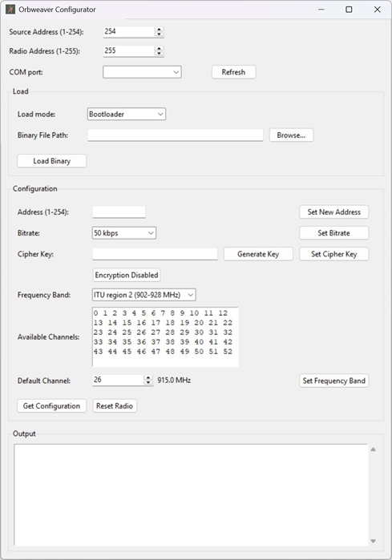

# Table of Contents
- [Introduction](#introduction)
- [Orbweaver Networks Explained](#orbweaver-networks-explained)
- [Help, programming guide, etc.](#help-programming-guide-etc)

# Introduction
Orbweaver is an open source HAT+ designed to mount on a Raspberry Pi 5. It is based around a Texas Instruments CC1310. It allows user to set-up secure wireless networks using desktops, laptops, Amdroid-based mobile devices, and Raspberry Pis without relying on existing networks. Orbweaver comes equipped with a debug header, so end users may write their own firmware or use Orbweaver as an alternative to a Texas Instruments CC1310 Eval Kit when evaluating the CC1310.

The Orbweaver much easier to use than HATs based around transcievers like the CC1101. Much of the communication complexity is embedded in the CC1310 firmware, which keeps the software lightweight and easy to understand.

### Comparison to Other Common Networking Technology
The nearest networking technology to Orbweaver are the various LoRa-based technologies like Meshtastic. Both operate in the Sub-GHz ISM band, but Orbweaver supports higher bitrates than LoRa, so applications like audio are possible with Orbweaver. 

Compared to LoRa, Orbweaver is much more customizable at runtime, so the user can easily fit Orbweaver to their particular application. Bitrate, frequency hopping, encryption, and operating frequency are all configurable at runtime.

Orbweaver is fully open source and utilizes standard modulation methods, so the firmware can theoretically be ported to radio SoCs from different manufacturers which are capable of interoperating. LoRa modulation is proprietary, and the transceivers are only available from Semtech. Semtech LoRa modules tend to be more expensive than CC1310s and other Sub-GHz devices.

Compared to WiFi, Orbweaver is capable of communicating much farther, is better at pentrating barriers, and consumes less power. However, the maximum over-the-air bitrate supported by Orbweaver is 500 kbps, which is much lower than WiFi, and too low for streaming video of any reasonable quality.

# Power
There are two ways Orbweaver may be powered. If it is mounted on a Raspberry Pi 5 via the 2x20 pin connector, it will be powered via the Raspberry Pi's +5 VDC rail. If Orbweaver is not mounted, it may be powered via USB. If Orbweaver is mounted and USB is connected, USB power will be used. The USB port is an upstream facing port only. This means that it will always consume power and can't be used as a power source for other USB devices.

Any modern cell phone power adapter (or similar power source) should be capable of powering Orbweaver. However, a power supply designed for use with a Raspberry Pi is recommended, especially if the Raspberry Pi and Orbweaver are being powered at the same time. Orbweaver may also be powered via a USB connector on a Desktop, Laptop, or Android mobile device. We can't vouch for every device in the world, but most modern devices should be capable of powering Orbweaver. A portable cell phone charger should also work. 

Generally, Orbweaver may be safely powered and unpowered with no special shutdown proceedure. That is, you can just plug it in and unplug it without risk. However, the following two exceptions exist:

One, when mounting Orbweaver on a Raspberry Pi, make sure both Orbweaver and the Raspberry Pi are unpowered. Orbweaver is designed to resist damage from stray current spikes on the the 2x20 pin connector (up to a point), so it will likely survive, but the Raspberry Pi may or may not.

Two, during loading and configuration, the Orbweaver onboard flash memory is written. Losing power during these operations may result in corrupting the flash. While this might result in a loss of configuration or even a loss of the current application firmware, it should not result in anything unrecoverable. That is, it should not be possible to brick the device even if power is removed at the worst possible time, but you might have to reload the firmware and reconfigure the device. Within 20-40 milliseconds or so of the device being loaded and/or configured, power can safely be removed at any time with no risk of memory corruption.

# Orbweaver Interfaces
Orbweaver contains 5 connectors (one of which is unpopulated), 4 LEDs and two buttons.

### USB Port
The Orbweaver USB port utilizes a USB to serial bridge. This means Orbweaver is recognized by the host device as a serial device not a USB device. This also means the host device must have a compatible serial driver installed. Any modern Windows, Linux, and Android device should already have a compatible driver. See the Orbweaver Programming Guide for more on serial communication.

Orbweaver VID and PID are:

VID: 0x1209  
PID: 0x7800

### 2x20 Pin Header Socket
The 2x20 pin header connector allows Orbweaver to be mounted on a Raspberry Pi 5. Once mounted, no USB connection is necessary. Orbweaver will be powered via the Raspberry Pi +5 VDC rail. Orbweaver can communicate with the Raspberry Pi via SPI. See the Orbweaver Programming Guide for more on SPI communication.

### 2x5 Pin Header Pins
The 2x5 pin header connector allows an XDS200 debug probe to be connected to Orbweaver. This allows the CC1310 to be programmed and debugged using JTAG. Note: Programming and debugging Orbweaver via JTAG may cause any of several adverse results including bricking Orbweaver.

### 1x7 Pin Header Pins
The 1x7 pin header connector is unpopulated. Because XDS200 debug probes tend to be rather expensive, this connector is included so Orbweaver maybe be programmed and debugged using the much cheaper Texas Instruments CC1310 Eval Kit as a debugger. Consult the Orbweaver schematics and CC1310 eval kit documentation for how to use the eval kit to debug Orbweaver. Note: As with the primary JTAG header,programming and debugging Orbweaver in this way may cause any of several adverse results including bricking Orbweaver.

### SMA Connector
The SMA connector is where the antenna must be connected. A through-hole SMA connector (as opposed to a uFL or surface-mount connector) was selected as it will resist wearing out even if various antennas are removed and replaced many times over the life of the device. It is also more resistant to damage if the antenna is accidently snagged or bumped. There are many SMA antennas available for sale. See the antenna section of this document for more.

### LEDs
PWR LED will be illuminated whenever power is applied.  
LED 3 will flash at 1 Hz whenever the application firmware is active.  
LED 1 toggles whenever a command is sent or received.  
LEDs 3, 2, and 1 will cycle in that order when ever the firmware bootloader is active.  
If only the PWR LED is illuminated either the ROM bootloader is active or Orbweaver is malfunctioning.  
LEDs 1 and 2 will flash to indicate various application update and bootloading operations.

### Buttons
Pressing and releasing buttons 1 and 2 switches the states of LEDs 1 and 2 respective.
Pressing and holding both buttons for 3.1 seconds activates the firmware bootloader. Cycle power or reset Orbweaver to active the application again.

# Programming, Bootloading, and OTA updates
Orbweaver contains two bootloaders: A firmware bootloader and a ROM bootloader. 

### Firmware Bootloader
The firmware and ROM bootloaders can only communicate via USB or SPI. They cannot use the radio. Orbweaver ships with the firmware bootloader already programmed, but without application firmware. So when a fresh from the factory Orbweaver is initially powered on, this bootloader should be active, and the application must be loaded via USB or SPI. Once the application firmware is loaded, the application can accept over-the-air updates using the radio. See the Orbweaver Quick Start Guide for instruction on loading and configuring Orbweaver.

All firmware updating via the firmware bootloader or application are fail-safe. Even if power is removed at the worst possible time during an update, Orbweaver should be able to recover and resume normal operation once power is restored.

If an Orbweaver is in a state that prevents the application from accepting an update (e.g. the configurator version being used is imcompatible with the active application), the firmware bootloader may be activated by holding both Orbweaver buttons for 1.3 seconds. The firmware bootloader can then be used to update the application.

### ROM Bootloader
The ROM bootloader exists as a fallback to the firmware bootloader. The ROM bootloader may be activated in two ways: One, if Orbweaver is mounted on a Raspberry Pi, the boot pin can be held low while the reset pin is pulled low then released. Two, the PCB boot throughholes can be shorted together while power is cycled. Once the ROM bootloader is active, only the PWR LED should be illuminated.

The ROM bootloader may be used to update the firmware bootloader. Note: If not performed properly, loading firmware with the ROM bootloader may result in adverse outcomes up to and including bricking Orbweaver.

### JTAG
The two JTAG connectors are explained in the Orbweaver Interfaces section of this document. They may be used along with a programmer and IDE for developing and debugging firmware.  They may also be used along with a programmer for erasing and programming the firmware bootloader and application using Texas Instruments SmartRF Programmer. Note: Using the JTAG connector to program and erase Orbweaver may result in adverse outcomes up to and including bricking Orbweaver.

# Orbweaver Configurator
The Configurator is used to configure Orbweaver and update Orbweaver application and bootloader firmware. Orbweaver Configurator is treated as a node on your network, therefore it must be assigned a unique address as described below in the Configurator Address section. A desktop version may be downloaded from the Orbweaver GitHub repo: [Orbweaver Releases](https://github.com/vespid-tech/orbweaver/releases). A Python CLI version can be found in the repo: [config](https://github.com/vespid-tech/orbweaver/tree/main/software/Python/config). Using the CLI version is detailed in the "CLI Updates and Configuration" section of this document. After cloning the repo run the script "ow_config.py" to run the CLI version. Both versions contain the same functionality.

The following shows the desktop version:

  

### Configurator Address
This is the address used by Orbweaver Configurator during update operations.

### Radio Address
This is the address of the target Orbweaver that is being updated or configured. If the target Orbweaver is directly connected via USB, 255 may be used regardless of the Orbweavers actual address. Any Orbweaver may be used to send updates over-the-air to remote Orbweavers on the same network. In that case, use the address of the remote Orbweaver. The USB connected Orbweaver will relay messages back and forth between the remote Orbweaver and the Configurator.

### COM port
The comport used to communicate to Orbweaver. Pressing refresh will cause the Configurator to search for connected Orbweavers and populate the dropdown control with the results of the search.

## Load
The controls in this section are used to load new application firmware into Orbweaver. they may also be used to load a new firmware bootloader using the ROM bootloader.

### Load Mode
Select Bootloader if the target Orbweaver has the bootloader active. Select Application if the target Orbweaver has an active application. Select ROM bootloader if the ROM bootloader is active. Note: over-the-air updates can only be sent to remote Orbweavers that have the application active. Orbweavers connected via USB may be updates with any of the three methods as necessary.

### Binary File Path
The path of the binary to load into the target Orbweaver.

Pressing "Load Binary" starts the loading process.

## Configuration
An Orbweaver will only respond to the controls in this section if an application is running on the Orbweaver. If either bootloader is active, the target Orbweaver will not respond to any of these controls.

### Address
The address to assign to the target Orbweaver. Pressing "Set New Address" sets the address. Note: If "Orbweaver Address" is set to the Orbweaver address instead of 255, and a new address is assigned, the Orbweaver will stop responding until "Radio Address" is set to the new address.

### Bitrate
The bitrate to assign to the target Orbweaver. All Orbweaver on the same network must have the same bitrate. Lower bitrates will generally allow for longer range communication but less bandwidth and vice versa. Pressing "Set Bitrate" sets the radio bitrate.

### Cipher Key
This is the key used to encrypt and decrypt messages sent via RF when encryption is enabled. All Orbweavers on the same network must use the same Cipher key. There is no command to retrieve a cipher key from an Orbweaver. It is up to the user to save the cipher key, and make sure the same key is loaded into every Orbweaver. Pressing "Set Cipher Key" will load the key, but it will not be used until encryption is enabled. Pressing the "Encryption Enabled/Encryption Disabled" button will toggle encryption.

### Frequency Band
In order to comply to local regulations, this should be set to reflect the ITU band the Orbweaver network will operate in. ITU Region 1 encompasses Europe, Africa, and West Asia. ITU Region 2 encompasses North and South America. For all other regions, select a band and Default Channel that is appropriate for the region. See the "Disclaimer and Legal Notice" section of this document for more.

"Available Channels" displays the channels available in the selected region, and "Default Channel" selects the channel that the Orbweaver will use by default (i.e. until it is changed by software or frequency hopping is enabled). The default channel frequency is displayed next to the "Default Channel." Pressing "Set Frequency Band" Sets the frequency band and default channel.

### Get Configuration
Retrieves the current Configuration.

### Test Orbweaver
Sends a test message to the radio. If a response is received it means radio communication is nominally functional. It does not perform a comprehensive system test. Test Radio will only work if the target Orbweaver has an application active.

### Reset Orbweaver
Sends a reset command to the target Orbweaver. After an Orbweaver is loaded and configured, it may be reset. As a final check, the configuration may be retrieved and verified against what was set. If the received configuration matches what was sent, it indicates the proper firmware was loaded and the configuration was successfully saved in flash memeory.

# CLI Updates and Configuration

# Orbweaver Networks Explained
Orbweavers are designed to allow anyone to set-up a peer-to-peer, ad Hoc, mobile, hybrid, mesh network. Here's what those term mean:

peer-to-peer: Every node can request and provide data. There is no designated client or server. Every node can function as either.  
ad hoc: Any node may communicate with any other node in range. No dedicated routers or switches exist. 
mobile: Nodes may move relative to each other or all together while communicating.
hybrid: The individual nodes on a network may communicate using different technologies. In the case of Orbweaver networks they may use RF, USB, or SPI.
mesh: Each node in the network is capable of routing messages to enable nodes that are out of range of each other to communicate.

For example, supposed you have a Raspberry Pi collecting data somewhere out of range of any WiFi network (or for some reason you are unable or unwilling to use WiFi). You want to access the data on that Rasperry Pi from a desktop some distance away. you may attach one Orbweaver to the Raspberry Pi and another to the desktop. The desktop and Raspberry Pi can now communicate via the Orbweaver network. Now supposed the Raspberry Pi is several kilometers away, too far for the Orbweavers to reach. A third (or as many as necessary) Orbweavers may be placed between the Raspberry Pi and desktop. The extra Orbweavers will forward the messages between the desktop and Respberry Pi.

Another example, you want to set-up secure communication between several Android mobile devices spread over a fairly large area without using existing cellular infrastructure. If each mobile device is connected to an Orbweaver, and an appropriate application is loaded on each mobile device, all the mobile devices will be able to communicate to one another on their own secure network.

## Orbweaver Network Topology
### Node
A node is any device (real or virtual) that is connected to an Orbweaver network. It may be an Orbweaver, an Android mobile device, a desktop (or software running on a desktop), or anything else equiped with a compatible USB serial port driver or capable of communicating via SPI that can send and receive properly formated messages.
### Subnet
A subnet consists of an Orbweaver, and all nodes connected to the Orbweaver via USB or SPI. Only one node can be physically connected via SPI one one via USB, but each of those devices may have up to 5 additional nodes connected to (or running on) them that the Orbweaver can route message to and from, so a single subnet may contain up to 13 nodes.
### Network
All of the nodes on all of the subnets capable of communicating with each other. An Orbweaver can only be a part of a single network. However, other computers (like desktops and Raspberry Pis) may be connected to more than one network at a time. For instance, if a Raspberry Pi has an Orbweaver mounted and a second connected via USB. The two Orbweaver can be node on two different networks. The Raspberry Pi can communicate to both. In this way networks may be chained together allowing the address space to be extended beyond 254 nodes.
### Addresses
Every node on a network must have a unique address. There are 255 addresses available (1-255). Address 0 is invalid, and cannot be used by any node. Address 255 is the broadcast address. Messages sent to this address will be received and processed by any node that receives it. All other numbers (1-254) may be used as node addresses. By convention, Orbweavers start with address 1 and count up. All non-Orbweaver nodes start at address 254 and count down. For instance, if you have a network consisting of 3 Orbweavers, a Raspberry Pi, and a desktop running a communication script and the Orbweaver Configurator. The Orbweavers may use addresses 1, 2, and 3. The Raspberry Pi may use address 254. The desktop communication script may use address 253, and the Orbweaver Configurator that is also running on the desktop may use address 252.

## Messaging 
All Orbweaver network communication is packet based. That is, all messages sent between nodes must be sent as properly formated packets called "system commands." For more on messaging see the Orbweaver Programming Guide.

# Frequency Bands
Orbeaver radios operate in one of two unlicensed ISM bands. ITU region 1 (Europe, Africa, and West Asian) has 15 channels ranging from 863 MHz to 870 MHz. ITU Region 2 (North and South America) has 53 channels ranging from 902 MHz to 928 MHz. Many if not most other regions of the world have unlicense bands that overlap with the frequencies used by ITU region 1 or 2, so a default channel from those bands may be used. If frequency hopping is enabled, the Orbweavers will hop through all the available channels in the select ITU region in random order.

See the Disclaimer and Legal Notice section of this document for more on this topic.

# Encryption and Security
### Key Storage

# Frequency Hopping

# Bandwidth, Bitrate, and Data Throughput

# Radio Range and How to Optimize It

## Fresnel Zone
## Operating Enviroment
## Bitrate
## Frequency
## Antenna
## Bi-Directional Amplifier
## Real-World Test Results

# Mounting on a Raspberry Pi and Case Options

# Help, Programming guide, etc.

# Disclaimer and Legal Notice